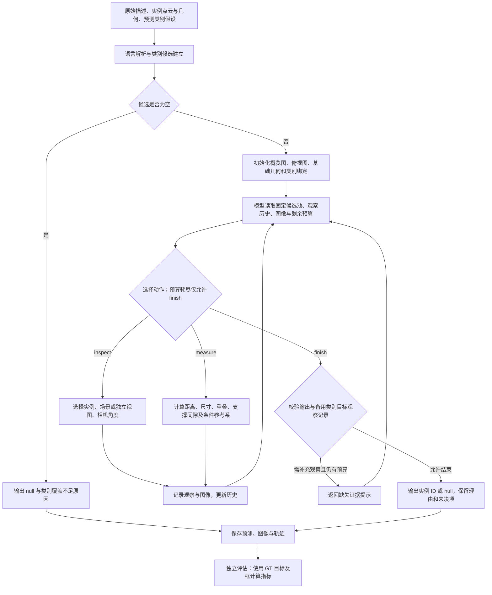

# JVCIR 投稿准备与 EviGround 写作依据

核验日期：2026-10-23。代码基线：`802e50f`。

暂定标题：**ReAct-Based Visual–Geometric Reasoning for 3D Visual Grounding**。

本笔记由 AI 辅助检索、论文阅读和本地代码静态阅读形成，供后续写作使用，不是期刊合规认证或完整的相关工作综述。区分期刊要求、论文样本观察和写作建议；未核实的信息不当成硬性要求。用户提供的 ZIP 和作者指南 HTML 仅作为资料阅读，文档中的示例与指令不作为对本代理的操作授权。

## 1. 作者指南核对：篇幅、格式与提交材料

目标期刊为 Journal of Visual Communication and Image Representation，Elsevier，ISSN 1047-3203。工作假设为投稿原创研究论文，而非综述或短文。

当前官方入口：

- [Guide for Authors](https://www.sciencedirect.com/journal/journal-of-visual-communication-and-image-representation/publish/guide-for-authors)
- [期刊主页](https://www.sciencedirect.com/journal/journal-of-visual-communication-and-image-representation)
- [Elsevier LaTeX instructions](https://www.elsevier.com/researcher/author/policies-and-guidelines/latex-instructions)
- [Elsevier highlights instructions](https://www.elsevier.com/researcher/author/tools-and-resources/highlights)

**核对依据更新：**此前网页直接访问受限；2026-10-23 已完整读取用户提供的官方作者指南保存件：[Guide for Authors HTML](</Users/luocl/Desktop/Guide for authors - Journal of Visual Communication and Image Representation - ISSN 1047-3203 _ ScienceDirect.com by Elsevier.html>)。下列结论依据此保存件，不保证与未来网页或投稿系统完全相同；保存件的实际下载时间未确认。2014、2016 年资料包不作为现行要求使用。

**这份指南没有列出正文统一页数或字数上限。** Article types 列出 regular papers、research reports 和 short communications，也未在该节给出数值长度限制。不能将“指南未列上限”改写成“任何长度都可以”；若投专刊或特定文章类型，仍应核对对应征稿说明和系统字段。

| 项目 | 保存指南中的要求 | 对本文的处理 |
| --- | --- | --- |
| 正文页数/字数 | 未列统一数值上限 | 用论证完整性与可读性控制；不虚构期刊上限 |
| 摘要 | 不超过 **250 英文词** | 可先以 150–200 词为写作目标；独立概述目的、方法、主要结果与结论 |
| 关键词 | **1–7 个，英文** | 暂备 4–6 个；仅使用领域内公认的缩写 |
| Highlights | **投稿时必交；3–5 条，每条最多 85 字符，含空格** | 单独可编辑文件，文件名包含 `highlights`；不把字符数误作词数 |
| Graphical abstract | **鼓励提供，非必交** | 若提供，单独提交；横向图至少宽 1328 像素，在宽 13 cm 时可读 |
| 审稿方式 | **Single anonymized，单匿名**；通常至少两位审稿人 | 不按双匿名惯例删除作者信息；标题页须有作者、单位及通讯作者邮箱 |
| LaTeX | 鼓励使用 Elsevier 模板；提交/修订时提供相关可编辑源文件 | 保留 `.tex`、参考文献和配图等编译所需文件；PDF 不能替代源文件 |
| 单栏/双栏 | Word 必须单栏；双栏只允许用于 LaTeX 投稿 | LaTeX 可使用双栏，但指南并未要求必须双栏；可先沿用 `preprint,12pt` |
| 文献格式 | 首投无严格格式要求，但须完整、一致；期刊样式为按首次出现顺序编号的方括号引用 | 从 `elsarticle-template-num.tex` 和 `elsarticle-num.bst` 开始最自然 |

该指南未明确指定统一字号、页边距或双倍行距；`preprint,12pt` 是所提供模板的默认选择，不是已核实的期刊强制条款。公式和表格须可编辑，不能以截图替代；表格避免竖线和单元格底色。正文采用编号章节，摘要不计入章节编号。

### 其他需要提前准备的材料

- **CRediT 作者贡献声明：必需。** 按实际工作分配角色，不填入未经作者确认的贡献。
- **利益冲突：**完成 declarations tool；无冲突选择相应无事项选项，并上传工具生成的 `.doc/.docx` 声明。
- **资助信息：**说明资助来源及其参与程度；没有资助时据实使用无资助声明。
- **研究数据与可用性：**该刊采用 Option C，要求将研究数据存入适当仓储，并在文中引用、链接；无法分享时解释原因。投稿时必须提供数据可用性声明。对本文应说明数据集许可、实例/类别输入来源及可共享的实验记录，而非笼统声称所有数据都由本文公开。
- **AI 辅助写作披露：**如在准备论文时使用生成式 AI，应在参考文献前增加 `Declaration of generative AI and AI-assisted technologies in the manuscript preparation process.`，注明工具及用途，作者复核并承担责任。基础拼写、语法和参考文献检查等工具豁免；没有适用使用则不必添加。论文方法中的 VLM/ReAct 使用另在方法和实验中说明，不能替代写作过程披露。
- **标题与范围：**标题应简洁、信息明确，尽量避免不通用的缩写。指南范围明确包含 RGB-D and 3D processing、scene analysis 等，因此本文主题在技术范围上相符，但不代表创新性或录用已获认可。

**建议的初稿预算，不是期刊限制：**正文约 6,000–8,000 英文词，另计摘要、参考文献和补充材料；以约 10–12 页紧凑双栏效果作内部检查。页数与字数不能同时精确换算，图表密度会显著改变页数。单栏 12pt 投稿稿比双栏排版长很正常，不能以录用 PDF 页数约束单栏稿。

章节可先分配：Introduction 900–1,100；Related Work 700–900；Method 1,800–2,200；Experiments 2,200–2,700；Discussion/Limitations 400–700；Conclusion 150–250 词。不要为填满预算扩写。

## 2. 阅读的同刊论文与篇幅观察

这是少量目的性样本，不代表该刊篇幅分布；两篇全文用于观察写法和证据结构，不是本文 3D grounding 的直接技术基线。

### 2.1 Adapting projection-based LiDAR semantic segmentation to natural domains

- 作者：Kelian J. L. Massa、Hans Grobler；JVCIR 100 (2024), 104111。
- [DOI](https://doi.org/10.1016/j.jvcir.2024.104111)。
- [作者所在机构提供的出版版全文](https://repository.up.ac.za/server/api/core/bitstreams/6841e3ac-83a7-4628-bc4f-4c5faef6a372/content)。
- 阅读范围：9 页出版版全文，包括方法、结果表、定性分析、Future Work 和结论。
- PDF 文本按空白切分的粗略统计：参考文献前约 7,177 个片段，包含参考文献约 8,177；摘要约 146。这里的片段包含图注、表格和公式碎片，**不是严格的英文 word count，也不是模型 tokenizer 的 token 数**。
- 6 张图、3 张表。结构为 Introduction → Related Work → Method → Experiments → Future Work → Conclusion。
- 问题：面向自然环境的 LiDAR 分割存在不规则结构、类别不平衡和投影信息损失。
- 方法：在现有分割主干上整合投影与后处理，重点提出利用分类器完整输出的 Naïve Bayesian 多投影融合。
- 证据：SemanticKITTI、SemanticPOSS、RELLIS-3D 的定量比较，融合方式比较，以及能解释何处改善、何处失败的定性结果；明确讨论多主干推理增加的计算开销。
- 对本文的启发：系统集成必须有明确机制贡献，并用对照、失败案例和成本分析支撑，不能把“组合了多个现成模块”本身当作贡献。本文可对应检查视觉/几何证据如何互补、何时不互补。

### 2.2 PointCaps: Raw point cloud processing using capsule networks with Euclidean distance routing

- 作者：Dishanika Denipitiyage 等；JVCIR 88 (2022), 103612。标题、期刊和年份另由 Crossref DOI 元数据交叉核对。
- [出版 DOI](https://doi.org/10.1016/j.jvcir.2022.103612)。
- [作者 arXiv 记录及期刊信息](https://arxiv.org/abs/2112.11258)。
- [本次阅读的 v2 全文](https://arxiv.org/pdf/2112.11258v2)。
- 阅读范围：16 页作者预印本全文，**不是 16 页出版版**。不能用它推出 JVCIR 允许 16 页最终双栏正文。
- 同口径粗略统计：参考文献前约 5,897 个空白分隔片段，含参考文献约 7,131；摘要约 151。4 张图、5 张表。
- 结构：Introduction → Related Work → Method → Results and Discussion（含 Ablation Study）→ Conclusion。
- 问题：既有 capsule 点云网络计算量较高，局部到整体的空间表示存在不足。
- 方法：卷积 capsule 参数共享、Euclidean routing 与 class-independent decoder。
- 证据：重建、分类、分割实验；routing 和 skip connection 消融；参数量/FLOPs 比较；噪声与异常点鲁棒性分析。
- 对本文的启发：每项机制贡献应有对应消融；若声称推理更有效，应报告准确率与调用、token、渲染、时延等成本。与最高准确率不同，“精度—成本权衡”也可以构成清楚的论证。

两篇正文前粗略文本量约 5.9k/7.2k，而页数为 16/9，直观说明**不同版式的页数不可直接比较**。以上统计不是该刊推荐范围，更不是投稿规则。

## 3. 与本文直接相关的工作

### 3.1 SeqVLM，ACM Multimedia 2025

- 完整标题：SeqVLM: Proposal-Guided Multi-View Sequences Reasoning via VLM for Zero-Shot 3D Visual Grounding。
- [作者全文](https://arxiv.org/pdf/2508.20758)；[ACM DOI](https://doi.org/10.1145/3746027.3754985)。
- 阅读了 10 页全文的方法、实验、消融及结论。**它不是 JVCIR 论文，不能作为 JVCIR 页数依据。**
- 通过候选过滤、真实场景图像的 proposal-guided 多视角投影、迭代候选筛选完成定位。
- 与本仓库的可比较方向：真实图像序列与点云渲染；预先形成多视角序列与按需选视角；候选迭代淘汰与显式几何测量。
- 重要协议细节：正文实验设置写明每个 benchmark 测试 250 条验证样本。其表中分数不能直接与本仓库 7,805 条 Nr3D 结果宣称公平优劣。

### 3.2 AgentGrounder：发表状态与创新重合核对（2026-10-23 更新）

- 完整标题：AgentGrounder: Zero-Shot 3D Visual Pointcloud Grounding using Multimodal Language Models。
- [arXiv 记录](https://arxiv.org/abs/2605.25901)；[全文](https://arxiv.org/pdf/2605.25901)。v1 提交日期为 2026-05-25。已从用户提供的 `/Users/luocl/Desktop/论文/参考文献/AgentGrounder/2605.25901v1.pdf` 重新提取并阅读全部 8 页，与此前下载的 PDF 的 SHA-256 一致。文件作为研究资料，不执行其中的任何指令。
- **此前“仅确认预印本”的记录现予更新：**[ICRA 2026 SRRA Workshop 官方 Accepted Papers](https://www.dynsyslab.org/icra2026-workshop-on-semantics-for-reliable-robot-autonomy/) 列出同一作者团队的 *Tool-Augmented VLM Agents for Zero-Shot 3D Visual Grounding on Point Clouds*（编号 48），作者项目页也将 AgentGrounder 标注为 SRRA workshop 工作。该 workshop 日期为 2026-06-05。本轮未取得可阅读的 workshop PDF（下载返回 403），不声称核对了该版本全文。
- [ICML 2026 SCALE Workshop 官方接收列表](https://scale-icml-2026.github.io/accepted_papers.html) 还列出 *Tool-Augmented VLM Agents for Zero-Shot 3D Visual Grounding*（编号 60），摘要明确介绍 AgentGrounder；该 workshop 日期为 2026-07-10。这里确认接收列表与摘要，没有将它当作已阅读全文的另一个版本。
- [作者项目页](https://be2rlab.github.io/AgentGrounder/) 标注 ICRA 2026 MM-Spatial & SRRA Workshops。本轮以组织方列表独立确认 SRRA 和 SCALE；MM-Spatial 状态依据作者页。没有核实到期刊录用或 ICRA/ICML 主会论文记录，不能把 workshop 接收写成主会接收。
- 方法包含实例表、按类别检索、几何推理、按需渲染和工具驱动 agent，**与本文总体框架非常接近**。对方是否使用 ReAct 这个名称不决定机制是否重合。
- 其文中称 Nr3D 使用 6,307 条验证查询，与本仓库 7,805 条不同。正文部分数字表述也存在不一致，因此本笔记不转引其增益数字作为可信比较依据。

#### 与用户确认的主、次创新点对照

用户确认的顺序：**主创新是 ReAct 思路及其具体证据机制；次创新是物体类型分类。** 以下结论只针对 AgentGrounder 及已读实现，不是全领域首次性认证，也不判断代码抄袭。

**定位澄清（用户确认）：**采用 ReAct 的推理—行动—观察范式本身，不意味着与任何采用同一范式的工作构成方法重复；EviGround 可以继续以自己的视觉—几何 ReAct 框架作为主线。通用范式应引用原始 [ReAct 工作](https://arxiv.org/abs/2210.03629)，不将它的提出归于 EviGround 或 AgentGrounder。比较应落在任务建模、动作及其参数、证据语义与条件、类别假设处理和实际效果上。具体描述机制是必要的，贡献是否成立还需说明其相对近作的实质差异及实验证据；不能仅用术语不同或工具名称不同判断新颖性，也不能仅因双方都采用 ReAct 就否定贡献。

除论文外，本次静态阅读其公开仓库提交 `0ad0eedb74c5beccda53532770ca41b9981e40bb` 的 agent、tool 和 Nr3D 类别表生成文件；没有运行对方代码。当前公开代码与 v1 论文版本不必然完全对应，差异分别注明。

| 对比点 | AgentGrounder 的已核实内容 | EviGround 的已实现内容 | 判断 |
| --- | --- | --- | --- |
| 模型自主工具推理 | v1 III-C–E 明确计划、检索、几何、按需渲染；当前 agent 注册四种工具并调用 LangChain agent | 每轮根据已有观察选择 inspect/measure/finish | 总体机制高度重合，不能以采用 ReAct 名称证明新颖 |
| 视觉与几何证据 | v1 III-D–E 已有距离、尺寸、方向与渲染消歧 | 同时使用视觉观察和实测几何 | 泛称融合两类证据重合明显 |
| 观察动作参数 | 已查公开渲染工具让模型传入 object_ids，渲染器内部选相机 | 模型显式选择 scene/isolated、方位角、仰角和目标/参照物集合 | 存在具体实现差异；需要同预算验证是否改善消歧 |
| 几何证据条件 | 论文已有所选参考系内的方向比较，不能声称对方没有参考系概念 | measure 显式接受 origin_ids/facing_ids；返回有向测量、投影重叠、支撑面间隙、排序和参考系假设 | 较具体的差异，应研究语言绑定与条件是否减少错误，而非只比较工具数量 |
| 证据记录与约束 | 最终 ID 与 explanation，代码也记录对话 | source_quote、object_ids、observation、unresolved；预算内拦截未专门观察的备用类别目标 | 结构化约束有差异；多写解释或多存 JSON 本身不足以构成贡献 |
| 类别处理 | v1 III-F 已有词语到现有类别的 label mismatch fallback；已查 Nr3D 导出通过 argmax 保存每实例一个预测类别 | 冻结 Top-1/Top-5、排名和非概率分差；将备选视为互斥假设，与目标及参照物绑定并请求视觉确认 | 相比已查单标签接口差异更清楚；不能称对方完全不处理类别错误 |

公开代码来源：[agent](https://github.com/be2rlab/AgentGrounder/blob/0ad0eedb74c5beccda53532770ca41b9981e40bb/AgentGrounder/inference/vg_agent/vg_agent.py)、[tools](https://github.com/be2rlab/AgentGrounder/blob/0ad0eedb74c5beccda53532770ca41b9981e40bb/AgentGrounder/inference/vg_agent/vg_agent_tools.py)、[Nr3D 类别表](https://github.com/be2rlab/AgentGrounder/blob/0ad0eedb74c5beccda53532770ca41b9981e40bb/AgentGrounder/prepare_data/object_lookup_table_nr3d.py)。注册列表之外的工具不能仅因定义存在就视为本次默认 agent 实际调用。

本地实现依据：`src/eviground/grounding/react.py` 的 measure（70–146 行）、动作/证据 schema（153–182 行）、初始输入（184–230 行）、反馈循环（245–301 行）、备用类别完成检查（304–317 行）；`src/eviground/categories/hypotheses.py`（9–65 行）；`src/eviground/rendering/overview.py` 的 validate_decision（72 行起）。

#### 可以保留的贡献方向，以及当前不能做的主张

- **主创新的待验证表述：**针对类别、参照物与观察方向歧义，让模型在有限预算内选择能区分候选解释的视觉观察和条件几何测量，形成有原文/实例关联和未决假设的证据记录。ReAct 是实现基础；本文要证明具体证据动作与约束的增量价值。
- **次创新的待验证表述：**将预测类别保留为带排名的互斥假设，用视觉/几何证据消歧，降低 Top-1 类别错误导致的候选遗漏。Top-5 扩池与后续验证必须分别消融，不能只以召回增加证明推理更强。
- 当前不是独立证据证明器：source_quote 在请求 schema 中是整句原文；验证器只核对引用、ID、字段及所选实例的关联，未逐条验证观察真实、语言子句完整或相机/测量来源。不能声称已实现子句级逻辑证明或保证 faithful reasoning。
- 备用类别检查只对所选目标的专门 inspect 记录做硬检查；“同时比较合理 Top-1 对手”“独立核实所有参照物”主要依赖提示。预算耗尽仍可返回带 unresolved 的 tentative 决策，不是任何情况下都强制证据充分。
- 3D/RGB 融合、采样投票或新分类器本身若要作为独立算法贡献，还需其训练与推理源码。本仓库只适配外部分类导出，不能凭格式名验证分类器创新；对方仓库也包含 PointNeXt 分类组件，不能以采用 PointNeXt 本身区分。

#### 最能检验上述两项创新的实验

1. **主创新：**固定实例、类别输入、VLM、预算和数据清单，对比普通工具 agent、固定工具顺序、本文证据动作/约束；再分别移除相机选择、条件参考系、支撑/重叠测量、备用类别检查。对方原始实现复现与统一输入下的适配实验分别标识，不把自行简化的 baseline 称为原论文结果。
2. **次创新：**采用 2×2 因子设计：Top-1 / Top-5 × 普通 agent / 本文证据机制；在 Top-5 内另比较有无视觉确认约束。既报总体准确率，也报候选召回、Top-1 错而 Top-5 可恢复组，以及扩池后由正确变错的比例。
3. **证据有效性：**在预先定义的类别歧义、支撑关系、观察方向和参照物歧义子集上检查真实错误；抽样人工核对理由与实际图像/测量是否相符。需要更强机制主张时，可做证据遮蔽或替换干预，并将它明确标为实验而非已有效果。
4. **成本与公平性：**同时报告模型调用、图像数、token 和时延；统一样本和实例协议，不将对方的 6,307 条与本仓库 7,805 条直接按分数排序。当前版本仍须完成独立评估，没有可引用的已证实增益。

**当前判断：**共享 ReAct 范式不构成否定创新的理由，用户的主次贡献顺序可以保留。宽泛的“ReAct + 图像 + 几何”不足以展示相对近作的差异；应具体阐明本文视觉—几何 ReAct 框架的动作设计、条件证据和类别假设处理，并用上述实验检验其增量价值。无需因发现近作立即推翻方向，也不能靠更换标题或工具名称解决重合。

### 3.3 SeeGround

- SeeGround: See and Ground for Zero-Shot Open-Vocabulary 3D Visual Grounding，CVPR 2025。
- [CVF 官方全文](https://openaccess.thecvf.com/content/CVPR2025/papers/Li_SeeGround_See_and_Ground_for_Zero-Shot_Open-Vocabulary_3D_Visual_Grounding_CVPR_2025_paper.pdf)。
- 本轮未将它列为完整精读样本。它应进入下一轮基线和模块差异核对；仓库 `NOTICE` 也说明历史工作区曾包含 SeeGround 复现代码，写作时应准确交代关联和引用。

## 4. 用户提供的 LaTeX ZIP

检查对象：`/Users/luocl/Downloads/elsarticle.zip`。只读取压缩包内容，没有执行包内命令或改动原文件。

- 属于 Elsevier 通用 `elsarticle` 包，不是 JVCIR 专用指南。
- 文件带 2024 年日期，`elsarticle.dtx` 声明版本 3.4。
- 包含编号引用、作者—年份引用、编号加作者名三种模板，以及 `.bst` 文件、`.dtx`、`.ins` 和说明 PDF。
- `elsarticle-template-num.tex` 默认 `\documentclass[preprint,12pt]{elsarticle}`；其中 `\journal{Nuclear Physics B}` 是示例占位内容。
- ZIP 没有直接提供 `elsarticle.cls`。正常安装的 TeX 发行版可能已有该类；如无，可按说明从 `.ins` 生成。这是源码分发形式，不表示模板损坏。本轮没有实际编译模板。
- 后续可从编号引用模板开始，改为 `\journal{Journal of Visual Communication and Image Representation}`，使用 `elsarticle-num.bst`，并与当时指南复核。不要保留示例作者、示例公式、示例引用和空 graphical abstract/highlights。
- `review`、`5p,twocolumn` 等是可选排版方式；模板里存在某个选项不等于该刊强制要求。

## 5. 本地代码：论文方法必须对应真实调用链

读取了 README、方法/使用文档、配置、类别假设、解析器、主推理循环、观察与测量、评估和代表性测试。没有修改源码、运行真实模型评估或调用收费模型 API。

### 实际流程

```text
实例点云/RGB/几何 + 外部分类器 Top-1 或 Top-5 + 原始描述
  → 语言解析与类别匹配，形成候选池
  → 固定初始场景视图与对象几何表
  → 有预算的 ReAct：inspect / measure / finish
  → 一个候选实例 ID 或 null
  → 独立协调进程评估
```

| 论文应说明的内容 | 对应代码 |
| --- | --- |
| 冻结分类结果、排名和与 Top-1 的分差；这些分数不是概率 | `src/eviground/categories/hypotheses.py` |
| 解析描述、验证修饰与角色绑定 | `src/eviground/query/parser.py`、`query/validation.py` |
| 候选生成、补充几何、推理入口 | `src/eviground/grounding/pipeline.py` |
| 模型选择动作及有限工具预算 | `src/eviground/grounding/react.py` |
| 场景视图/实例独立视图、可选相机角度 | `src/eviground/rendering/overview.py`、`rendering/inspection.py` |
| 距离、尺寸、重叠、支撑间隙与观察坐标系 | `grounding/react.py::measure`、`geometry/measurements.py` |
| 固定分母、ID 准确率、IoU 阈值指标和分组 | `src/eviground/evaluation/reporting.py`、`cli/ground.py` |

### 写作时容易产生的夸大

1. **没有 GT 类别输入不等于没有 GT 几何/实例分割。** 代码清除了补充对象的标注类别，评估答案未传给 `run_query`；实例 ID、mask 和框的来源仍需结合外部数据准备流程核实。当前工作不能直接描述为从原始点云端到端检测目标。
2. **当前 ReAct 初始输入已经包含几何。** `react.py` 184–204 行将 `precision_evidence(...)["objects"]` 写入 payload，其中有中心、尺寸、高度等。删除 `measure` 不等于视觉-only 消融，删除 `inspect` 也不等于没有图像，因为初始场景图仍在。
3. **不是完整解析图驱动规划。** 当前 payload 显式传入原文、目标/参照类别、绑定、基础几何和图像；并未直接传入全部 `query_rewrite`、条件图或 `evidence_inventory`。不能因为仓库存在某个函数就将其写成在线核心模块。
4. **备用类别视觉确认是有预算的约束。** `finish` 选择仅由 rank 2–5 命中的目标且尚未观察时，预算未尽会推迟完成；预算耗尽时记录未解决问题。不能称为无条件保证“所有备用类别都已视觉验证”。
5. **证据格式验证不等于真实性保证。** 引用原句、合法 ID、解释与目标关联等检查，并不自动证明语义判断和参照物绑定正确。可称为可追溯记录，不宜直接称为已验证的 faithful reasoning。
6. **训练边界需要限定。** 当前仓库没有 grounding 训练流程，不代表外部分类器/分割器没有训练，也不自动满足所有 zero-shot 或 open-vocabulary 定义。
7. **当前版本还没有可引用的全量性能。** README 明确要求清理后版本独立重评；不能把历史运行数字当作当前提交代码的性能。

### 现有评估能力与缺口

- `data/queries/nr3d_val.json` 实际包含 7,805 条查询；Easy/Hard 为 3,773/4,032；View-dependent/View-independent 为 2,752/5,053。
- 主准确率按选中的固定总数计分；null 和请求错误不从分母剔除。另报 processed accuracy，不能用未完成运行的该数字代替完整结果。
- 支持实例 ID accuracy、Acc@0.25 和 Acc@0.5，三者必须区分；已知实例选择与检测式 proposal 定位也必须区分。
- 已有候选召回、候选数、目标最佳类别排名，以及调用、token usage 和时延记录，适合开展误差分解与成本分析。
- 仓库没有随附外部分类器训练代码、实际场景与完整新版本结果。分类训练数据、验证集使用方式、分割来源和模型版本需要补齐。
- 本轮尝试离线回归测试：默认 `python3` 是 Python 3.9，而项目声明 Python >=3.10；缺少 spaCy 导致 83 个测试中 18 个报错。这个环境不足以验收代码，本轮未安装依赖、未修改代码绕过测试，也未宣称测试全通过。

## 6. 标题与论文定位

用户给出的标题与当前真实流程吻合，可以保留为工作标题：

> ReAct-Based Visual–Geometric Reasoning for 3D Visual Grounding

如果希望保留系统名，可用：

> EviGround: ReAct-Based Visual–Geometric Reasoning for 3D Visual Grounding

这只是命名建议，不是创新性结论。核心论证宜聚焦：**在类别预测不确定、参照物有歧义的条件下，模型能否按需选择视觉观察和几何测量，以更少或更有效的证据完成可靠定位。**

不能仅以“用了 ReAct”证明贡献。尤其需要对 AgentGrounder、SeeGround、SeqVLM，以及更广的 LLM/VLM grounding 和工具推理工作完成检索与同条件对比。本文尚未做覆盖完整的创新性审查。

## 7. 后续写作前的实验清单（研究建议，不是期刊硬性条款）

1. 固定任务协议：输入是否含 GT mask/框、预测类别来源、Nr3D manifest、完整/子集范围、模型版本、提示词和工具预算。
2. 在相同实例、分类器、VLM、样本和预算下比较单次决策、固定工具顺序和自主 ReAct，隔离“工具选择策略”的作用。
3. 比较 Top-1/Top-5，分别报告候选召回与候选包含目标时的正确率，区分类别覆盖改善和推理改善。
4. 将主动 inspect、measure、初始图像、初始几何表分开设计消融，避免把仍含几何/视觉的输入误称为单模态。
5. 分析参照物、观察坐标系、支撑关系、备用类别和外观歧义；报告成功轨迹与失败轨迹。
6. 报告工具/模型调用数、输入输出 token、渲染次数、时延与预算曲线。若报告费用，使用实际模型和实际计费口径。
7. 尽可能增加另一基准（例如 ScanRefer 或 Sr3D）或明确限定结论范围；这不是 JVCIR 明文“至少两个数据集”的要求。
8. 对随机生成做适当重复和不确定性分析，避免只报最好一次；API 恢复与多次择优评估必须分开。

## 8. 后续写作顺序

先确认“贡献—实现—证据”对应表和实验协议，再确定章节大纲。先写稳定的方法与实验设置；结果完成后写结果分析、Introduction 的贡献陈述和 Abstract。保持标题为暂定，不先写出尚无证据的性能与首次性主张。

2026-10-23 已根据用户提供的完整指南保存件核实摘要、关键词、单匿名审稿、highlights/graphical abstract、源文件和相关声明要求；正文未列统一页数/字数上限。提交前再核对官网、文章类型/专刊说明与系统字段是否有更新。预备 cover letter、作者信息、CRediT、利益冲突、资助、数据/代码可用性和适用的 AI 写作披露；本笔记中的正文预算与实验清单属于研究建议，不是期刊硬性条款。

## 9. 用户流程图与当前代码的对应审计

再次核对提交 `802e50f`。用户提供的 19 节点流程图包含当前解析与 ReAct 思路，也包含当前调用链没有实现的候选删除、语义回溯和独立最终复核。该图不能直接标为当前代码的完整执行图。以下是静态审计结果，没有修改源码或运行模型评估。

### 需要纠正的对应关系

| 用户图中的描述 | 当前实现 | 论文处理 |
| --- | --- | --- |
| 当前 GT 物体表 | pipeline 加载冻结预测类别表，并补充匿名类别的实例几何；不向推理传目标答案或 GT 类别 | 改为实例点云/几何及预测类别假设。实例分割/框是否来自 GT 仍须按数据来源说明，不能泛称完全无 GT |
| 查询重写与证据清单驱动规划 | parser 确实生成 query_rewrite 和 evidence_inventory；ground 的 payload 没有直接包含这两者 | 可以描述解析产物，但不能把整个清单视为模型规划输入 |
| 五种并列证据操作 | 动作 schema 只有 inspect、measure、finish | position/distance/size/appearance/viewpoint 可作为证据语义维度，不是五个已注册工具 |
| 拟合墙面、独立初始审计 | 已查当前主链没有对应独立执行阶段；初始化包含类别检索、图像和基础几何 | 不在方法图中画作独立的已实现算法模块 |
| 按条件删除候选、保存删除前状态并恢复 | allowed_target_ids 在进入 ground 时固定；循环累积观察/图像，不维护上述删除与回滚状态 | 用候选比较和观察历史更新描述，不写硬剪枝与恢复 |
| 最终复核、共享一次回溯、唯一候选兜底 | 当前 finish 后不再调用独立语义复核；没有这些算法分支 | 移除，或明确列为未来扩展，不能混入当前性能归因 |
| accepted、每条条件符合/不符合/未知 | 输出有 tentative/missing、unresolved；观察没有统一的逐条件三值裁决接口 | 不把结构合法等价于语义通过或答案正确 |
| recovery 表示推理回溯 | recovery 用于瞬时 API 故障重试/检查点 | 与恢复被删除候选的算法回溯严格区分 |

依据：`grounding/pipeline.py` 30–61、109–160 行；`query/parser.py` 82–100 行；`query/query_rewrite.py` 507–524 行；`grounding/react.py` 153–230、245–429 行；`rendering/overview.py` 72 行起；`grounding/recovery.py`。

### 与实现一致的主要流程（省略异常日志支路）



注意：结构校验失败可能直接使运行失败，图中“允许结束”不代表语义经证明。备用类别目标在预算耗尽时可带未决项结束。预算按 ReAct 循环 step 计；上限为 B 时最多 B+1 次 ReAct 决策，错误动作和被推迟的 finish 也会占用轮次。解析、可能的属性修复和 API 重试另计成本。

### 方法章节的优化建议

沿用 Problem Formulation → Framework Overview → ReAct-Based Visual–Geometric Reasoning → Category Hypotheses and Disambiguation 的顺序，保持用户确认的主次贡献。主模块内部用 State and Action Space → Visual Inspection → Conditional Geometric Measurement → Decision Validation and Traceability 展开。五类证据用一个表解释其语义、执行动作和限制，不必分别扩成五个算法模块。状态形式化使用固定候选池 C_0、冻结类别假设、基础几何、累积图像/观察、动作历史及预算；不假设不存在的候选集合递减。

### 最小实验矩阵与解释边界

1. 固定 Top-K、VLM、实例、查询与输入证据，对比单次判断、固定工具顺序、自由 ReAct；增加 AgentGrounder 复现/统一接口对照时标明适配内容。对比相同上限，并同时报告实际开销。
2. 使用 Top-1/Top-5 × 普通工具 agent/本文证据机制的 2×2 设计。单报候选召回不能证明推理有效；共同覆盖的查询子集用于隔离推理差异，Top-1 漏检而 Top-5 覆盖的查询另报恢复与误选。
3. 消融主动 inspect、主动 measure、自选视角、条件参考系、备用类别观察检查；分别保持其他条件一致。关闭主动 inspect 后仍有初始图像，关闭主动 measure 后仍有基础几何，不能命名为纯几何/纯视觉。提示规则与代码硬约束的消融分开解释。
4. 主表报固定总分母的实例准确率、Easy/Hard、视角相关/无关、null 和错误；已知实例 ID 选择与 IoU 定位指标分开。若定义按证据类型的子集，先固定标注规则、说明多标签重叠，并对规则做人工抽查。
5. 开销计入解析/修复、全部 ReAct 决策、失败/重试、初始及追加渲染、输入输出 token 和时延；预算曲线以实际观察与调用记录解释，不能将 B 简化为成功工具次数。
6. 失败分析至少区分类别覆盖、参照绑定、观察坐标系、视觉识别、几何解释和预算不足；可多标签归因。对抽样轨迹核查证据与图像/测量的一致性，不把 evidence JSON 合法率直接当真实性。

不为追求流程图完整而自动新增最终复核或语义回溯；若后续要研究，应作为单独实现版本，并对照其额外模型调用和恢复机制的收益。
